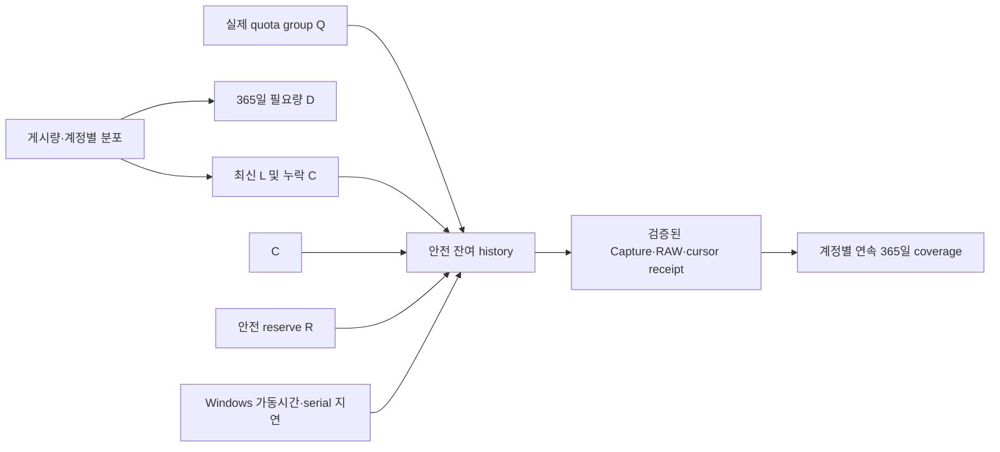

# P50 / n8n 목표 달성 가상 운영 분석 — Simulation v2.0

**기준일:** 2026-10-22 KST
**대상:** P50 50계정 목표, n8n 운영 연동 경계
**근거 설계:** [P50 목표 중심 설계 v3.0](https://github.com/hibi89/ohora-trend-catcher/blob/design/p50-manual-cycle-simulation-v2-20261022/docs/P50_GOAL_DRIVEN_SIMULATION_ARCHITECTURE_V3_2026-10-22.md)
**기준 브랜치:** `codex/p6-readiness-hardening-20261019` (코드/운영 설정은 이 분석에서 변경하지 않음)

> 이 문서는 조건부 산술 모델이다. API quota, 계정별 게시량, 지연, 자동 운영 결과를 실측한 보고서가 아니다. 모델의 green 결과는 실제 API 수집이나 365일 coverage를 증명하지 않는다.

## 1. 목적과 성공 증거

사용자 목표는 50계정의 매일 최신 관측과 필수 누락 복구를 먼저 수행하고, 남은 안전 처리량으로 초기 기준일 직전 365일의 게시물을 계정별 연속 증명 가능한 상태까지 과거 수집하는 것이다. 다음 KST 날짜의 최신 작업은 과거 history cursor를 초기화하지 않아야 한다. 성공 단위는 API 성공 건수가 아니라 계정별 verified cursor chain과 Capture→RAW→history receipt의 일치다.

| 지표 | 완료 증거 | 현재 상태 |
|---|---|---|
| P50 최신 수집 | 요청·Capture·RAW·observation receipt 대응 및 대상 계정 상태 | 별도 승인된 1페이지의 과거 성공 증거가 있음. 이번 작업에서 live call 없음 |
| 과거 수집 시작/재개 | latest anchor, history receipt, account/epoch/seq/cursor 연결 | P50 tip `0b330fc`의 pilot CLI에 history/recover dispatch가 연결되지 않음 |
| 다음 날 연속성 | 새 daily latest 이후 history epoch/cursor 불변 및 다음 seq receipt | 설계 조건. 현재 n8n 흐름에서 실증되지 않음 |
| 365일 coverage | 50계정 각각 cutoff 또는 명시된 terminal까지 검증된 chain | 미완료·미검증 |
| 자동 운영 | 승인된 환경의 n8n 실행 기록, lock/receipt/오류 전이 | workflow 비활성, local n8n 프로세스 없음, 원격 host 미확인 |

## 2. 변수 카드

`[F]` 고정 설계/관찰, `[D]` 근거 있는 도출, `[H]` 명시적 가상 예시, `[U]` 미확인이다.

| 변수 | 단위와 현재 범위 | 상태/근거 |
|---|---|---|
| `N` 대상 계정 | 50 | `[F]` P50 선택 로스터 수 |
| `m` 페이지당 게시물 | 게시물/요청, 0–4 | `[F]` `limit=4`; 실제 페이지 밀도 `[U]` |
| `L_t` daily latest | 페이지/일, 0–150 | `[F]` 50×최대 3페이지 상한; 실제 사용 `[U]` |
| `C_t` required catchup | 페이지/일, 0 이상 | `[U]` missed latest/anchor 깊이에 따라 변동 |
| `R_t` 안전 예비량 | 페이지 비용/일, 0 이상 | `[U]` 실제 quota와 운영상 필요한 reserve 미정 |
| `Q_g(t)` 안전 가용량 | 페이지 비용/일, 그룹별 | `[U]` A/B/C 독립/공유, 다른 수집기 소비량, 실제 한도 미계측 |
| `D_365` history backlog | 검증 필요 페이지 | `[U]`; 계정별 `Σ_i ceil(N_i/4)`로 구해야 함 |
| `q_i` 유효 history page 비율 | 0–1 | `[U]`; 삭제/중복/terminal/불완전 페이지 포함 실측 필요 |
| `d_i` 요청/저장 wall time | 초/페이지 | `[U]`; P50/P95 또는 평균을 가정하지 않음 |
| `T_t` host 가동시간 | 초/일 | `[U]`; Windows sleep/offline 및 승인 대기 포함 |
| History intake | 추가 eligible 페이지/일 | `[U]`; 목표 cutoff 및 overlap 처리 자료가 필요 |

관계: 게시 빈도/누락 → `L_t,C_t,D_365`; quota 공유·타 실행 소비 → `Q_g`; PC 가동 및 serial latency → `T_t` 안에 끝나는 유효 요청 수; receipts/cursor 정합 → history 완료량과 365일 coverage.



## 3. 계산 규칙 및 공유 한도

동일 quota group 안에서 페이지 요청 비용을 1로 단순화하면 설계상 history 상한은 다음과 같다.

```text
H_t = max(0, Q_t − L_t − C_t − R_t)
B_(t+1) = max(0, B_t + new_history_eligible_t − verified_history_pages_t)
verified_history_pages_t <= H_t
```

`Q_t`는 각 레인의 85% stop gate 및 65분 제약, 다른 실행기의 소비, 실제 usage 증거를 반영한 뒤에만 설정할 수 있다. A/B/C가 세 개라는 사실만으로 `Q`를 세 배로 계산하지 않는다. 그룹이 여러 개면 모든 그룹에서 `Σ(cost of assigned jobs) ≤ Q_g − other_consumption_g`가 성립해야 한다. API 응답이 불명인 요청은 재발송하지 않으며, 그 요청을 성공량으로 세지 않는다.

serial 처리의 wall-time 조건도 별도다. `Σ d_i`가 남은 host 실행시간보다 크면 quota 상한에 도달하기 전에 해당 일자의 job이 끝나지 않을 수 있다. `d_i`, OS 가동시간, n8n 지연의 분포가 없으므로 실제 일 처리량은 계산 불가다.

## 4. 하루·주·30일 가상 운영

아래 값은 API 그룹 한 개, 요청 비용 1, 최신 최대 `L=150`, 성공·receipt 검증 100%, 무중복, quota 외 사용 없음, 충분한 host 시간이라는 `[H]` 조건의 상한이다. 실제성 또는 확률을 뜻하지 않는다. 추가 history intake를 단순화를 위해 0으로 두어 backlog 감소만 계산한다.

| 경우 | 가상 `Q` | `L/C/R` | history `H` | 1일 | 7일 | 30일 | base `D=1,950` 최소 일수 |
|---|---:|---:|---:|---:|---:|---:|---:|
| 넉넉한 가상 quota | 200 | 150/0/0 | 50 | 50 | 350 | 1,500 | 39 |
| 경계 quota + catchup/reserve | 200 | 150/20/10 | 20 | 20 | 140 | 600 | 98 |
| 최신이 quota를 모두 씀 | 150 | 150/0/0 | 0 | 0 | 0 | 0 | 무한/정체 |
| quota 가용량이 최신+복구+예비 이하 | `Q≤L+C+R` | 가변 | 0 | 0 | 0 | 0 | 무한/정체 |

상한별 초기 backlog의 이상적 lower bound:

| 가상 `D_365` | 설명용 게시량 가정 | `H=50` | `H=20` | `H=0` |
|---:|---|---:|---:|---|
| 650 pages | 50계정 각 주 1개 | 13일 | 33일 | 진행 없음 |
| 1,950 pages | 50계정 각 주 3개 | 39일 | 98일 | 진행 없음 |
| 6,500 pages | 50계정 각 주 10개 | 130일 | 325일 | 진행 없음 |

게시량 시나리오는 v3 문서의 설명용 가정이다. 실제 `D_365`는 계정별 페이지 반올림, overlap, terminal/삭제, 실제 API-visible 결과로 다시 계산해야 한다. 자정 전후 latest/catchup 부하와 새 history intake가 생기면 `B_t`는 위보다 느리게 줄거나 늘 수 있다. 페이지 수만으로 실제 완료일을 약속할 수 없다.

### 목표 기한의 임계치 (base 1,950 pages)

동일 그룹, `L=150`, `C=R=0`이면 365일 history를 완료하기 위한 이상적 평균은 다음과 같다.

| 가상 기한 | 필요한 verified history pages/일 이상 | 필요한 `Q` 이상 |
|---:|---:|---:|
| 7일 | 279 | 429 |
| 14일 | 140 | 290 |
| 30일 | 65 | 215 |

실제 catchup과 reserve가 있으면 필요한 `Q`는 각각 `429+C+R`, `290+C+R`, `215+C+R` 이상이다. quota 그룹별 공유와 wall-time을 만족하지 못하면 이 임계치도 충분조건이 아니다. 처리 기한을 정하지 않은 최종 목표라면 핵심 feasibility 조건은 장기 평균 verified `H_t > new_history_eligible_t`다. 그렇지 않으면 backlog는 줄지 않는다.

## 5. 장애·복구 시간축

| 가상 시점/장애 | 안전한 상태 전이 | 목표 영향 |
|---|---|---|
| 매일 KST latest | latest/catchup 우선, 85% gate와 daily page cap 안에서 수행 | history 호출 여력 감소; latest receipt는 history cursor와 분리 |
| quota 경계/usage 증거 부족 | hold/cooldown, history `H=0` 또는 보수적 block | 그날 history 진척 0; 임의 재시도 금지 |
| Windows sleep/network offline | 실행 중지; 미확인 요청은 자동 전송 금지; 다음에 durable receipt/cursor로 판정 | 가동일수 감소, latest miss로 이후 `C_t` 증가 가능 |
| Capture 후 RAW/checkpoint 실패 | 마지막 검증 receipt 기준으로 reconcile; 검증 전 cursor 전진 금지 | `q_i` 감소/복구 비용 증가, 요청 재전송은 contract가 허용한 증거로만 |
| manual run과 n8n 동시 실행 | 공유 lock/lease가 없으면 두 번째 실행 중단 | 중복/불확실 요청 방지; n8n single tick만으로 별도 수집기와의 lock 보장은 안 됨 |
| 날짜 전환 | 새 daily latest를 우선하되 history epoch/cursor 유지 | history chain은 이어짐. 현재 n8n CLI 연동은 아직 이를 호출하지 못함 |
| Sheets 부분 저장 | RAW가 source of truth; checkpoint는 외부 쓰기 확인 뒤 전진 | P6 export contract의 idempotency가 필요; Sheets 오류는 원본 수집 성공에 영향 주지 않음 |

85% 제한과 쿨다운은 이 모델에서 언제나 정지 조건으로 유지한다. 속도 향상을 위해 batch/병렬화/재시도를 통한 우회는 계산하지 않는다.

## 6. 민감도·병목과 목표 판정

1. **`Q_g` 및 quota 공유**가 1순위 병목이다. `Q≤L+C+R`가 지속되면 코드가 정상이어도 history 진척은 0이다.
2. **`D_365`와 게시물 분포**가 완료기간을 정한다. 650/1,950/6,500 페이지는 근거 있는 실측 범위가 아니라 v3의 세 가정이다.
3. **Windows 가동시간과 serial 지연**이 quota 여력을 실제 완료 페이지로 바꾼다. 현재는 latency/uptime 측정치가 없다.
4. **계약 경계**가 현재 직접적인 n8n blocker다. P50 tip `0b330fc`의 pilot CLI는 latest-only; history/recover dispatch가 없어 n8n에서 P50 365일 history를 실행·재개할 수 없다. 새 모듈 내부 구현만으로 n8n 도달 가능성을 증명하지 않는다.

**v2 판정: `UNKNOWN` / 현재 history 자동운영은 `BLOCKED BY INTERFACE`.** 목표 365일 coverage의 달성확률이나 실제 완료일은 산출하지 않는다. 조건부로, 장기 평균 quota가 latest+catchup+reserve 및 다른 공유 소비를 넘어 양의 history 여력을 제공하고, host 시간 및 cursor/receipt chain이 유지되면 점진적 완성은 가능하다. 실제 quota/계정 게시량/가동시간이 없어서 `PROVEN CONDITIONAL`보다 강하게 판정할 수 없다.

## 7. 가장 작은 다음 단계

1. P50 담당자가 stable `latest/history/status/recover` CLI와 receipt contract를 내면 그 계약만 n8n adapter에 연동한다. P50 내부 history runner를 n8n 담당자가 복제하지 않는다.
2. 동일한 request limit, 85% stop, 65분 cooldown, A/B/C serial policy로 mock day/week/month acceptance test를 계약에 맞춘다. 중복 실행, 결과 불명, crash cuts, next-day cursor preservation을 포함한다.
3. quota-group sharing, `L/C/R`, per-account `D_365`, `d_i`, Windows uptime을 읽기 전용 evidence/합법적인 승인된 측정으로 채운 뒤 조건식을 다시 계산한다.
4. local A안을 전제로 격리 n8n profile과 host startup/Execute Command allowlist를 오프라인 검증한다. 기존 daily workflows와 credential scope를 확인하기 전에는 프로필을 시작하거나 workflow를 import하지 않는다.
5. 운영 cadence, API call 예산, 추가 Meta 호출, production schedule마다 별도 승인을 받는다. 5분 반복 live 호출, P294 activation, `main` merge는 이 분석으로 승인되지 않는다.

## 8. 증거와 한계

- `[F]` P50 v3 lines 14–16, 39–47, 92–99, 103–137, 242–245, 272–279: 목표, 변수, queue equations, illustrative D/Q arithmetic, quota/group unknowns, current design-only판정.
- `[F]` GitHub P50 owner tip `0b330fc0d04317a2949b42bf83e7310b4afe9cef`; pilot entrypoint checks show latest flags, no history/recover/status dispatch. Current CI is mixed: P50 validation runs `39737113080` and `39737108191`, plus history `39737108250`, SUCCESS; Three API `39737113093` and P6 Runtime `39737113072` IN_PROGRESS; C Contract `39737113042` and frozen guard `39737113228` SUCCESS.
- `[F]` Local Windows probe: n8n CLI `2.40.7`, no n8n/Node process, no listener on `5678`, `5680`, `5681`. The workflow invokes `powershell.exe`; remote academy host is not recorded in repository evidence.
- `[H]` `Q=200`, `L=150`, `C/R` scenarios and `H=50/20/0` are deterministic arithmetic examples only.
- `[U]` Real quota, group sharing, account cadence, history backlog, receipt success ratio, API latency, host uptime, remote n8n host and production schedule behavior.
- No Meta call, DB/RAW/Capture mutation, n8n instance start/import, workflow activation, P294 run or main merge was performed for this analysis.
